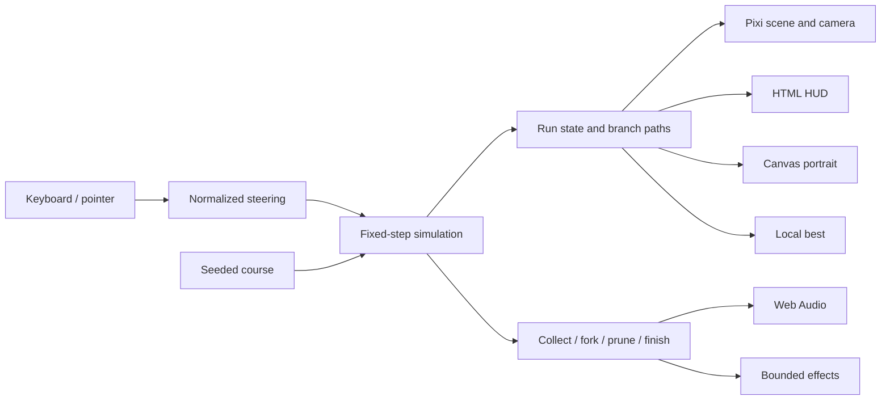

# Boughbound architecture

Decision date: 14 October 2026. Repository codename: `lightward`.

## Objective

Deliver one immediately playable, visually distinctive, reliable browser game for Project Treetop Round 01. The differentiator is synchronized control of several growing branch tips, with a permanent visual record of the choices made during a run. The engineering should make tuning and verification cheap. Complexity that does not improve the judge's first two minutes is deferred.

## Stack and boundaries

| Layer | Choice | Responsibility |
| --- | --- | --- |
| Build | Vite, TypeScript strict mode, npm lockfile | Local development and static production assets |
| Simulation | Plain TypeScript, fixed 60 Hz steps | Movement, branching, collisions, deterministic course, score, victory/death |
| Scene | PixiJS 8, WebGL | World, branches, hazards, particles and camera |
| Menus | Semantic HTML and CSS | Title, instructions, pause, settings, result actions and keyboard focus |
| Audio | Web Audio API | Original synthesized notes; starts after user interaction |
| Persistence | Versioned localStorage record | Best score and preferences; failure never blocks play |
| Portrait | Canvas 2D | Export original branch geometry as a botanical specimen PNG |
| Verification | Vitest, TypeScript, browser inspection | Gameplay invariants, production build, interaction and layout |
| Hosting | Static HTTPS deployment, target Vercel | Public link with no login or installation |

No React render loop, backend, game-service account, wallet SDK, remote AI calls, multiplayer, or public leaderboard is required for the entry. A global leaderboard would need trusted scoring and moderation, so it is outside this deadline.



## Module ownership

```text
src/
  main.ts                 boot, application states, DOM and game loop
  config.ts               title and shared product constants
  style.css               responsive shell and typography
  game/
    types.ts              serializable simulation contracts
    random.ts             deterministic PRNG
    course.ts             authored introduction + seeded obstacle patterns
    simulation.ts         fixed-step game rules, no browser dependencies
    simulation.test.ts    meaningful rule and fairness regression checks
  platform/
    input.ts              pointer capture, keyboard, focus cleanup
    audio.ts              bounded synth voices and mute
    storage.ts            guarded versioned persistence
    portrait.ts           full-run geometry projection and PNG export
  render/
    scene.ts              Pixi world, camera and visual effects
    atmosphere.ts         original procedural landscape textures
  dev/
    qa.ts                 local-only replay/context checks; excluded from production
```

## Simulation contract

`RunState` owns elapsed simulation time, seed, phase, live tips, branches, course entities, score, light collected and maximum simultaneous tips. Branch IDs and entity IDs are monotonic and stable. A branch stores a parent reference, its sampled path and whether it forked or withered. A live tip references exactly one terminal branch. A fork retires one live tip and creates two children at its last point; net live count increases by one. Pruned tips never resume, and their earlier paths remain in the portrait.

`stepRun(state, steer)` advances exactly 1/60 second and returns typed effects. It never reads DOM, clock, storage or `Math.random()`. Steering is clamped to [-1, 1]. A fixed seed and fixed input sequence give the same run in the same engine. This is a reproducibility aid, not a promise of bit-exact cross-browser replay or anti-cheat.

Order: advance time; move living tips; detect swept collisions; resolve losses; resolve each pickup once using a stable tip order; create forks; update score and sampled paths; resolve finish. Hazards win simultaneous pickup/hazard conflicts. New tips begin movement on the following step. At most six tips live at once. A fork pickup at the cap converts to a light bonus.

## Steering and fairness

All tips receive the same horizontal steering velocity. Newly forked tips receive opposite lateral impulses that decay; they do not diverge forever. This keeps the control legible while retaining multiple positions to protect. Edges bend growth inward rather than silently killing tips. Hazards have visible silhouettes, conservative hitboxes, and several seconds of preview. The opening demonstrates a fork before introducing lethal hazards.

Touch and pen gestures reach full steering at 28 CSS pixels of displacement; a mouse uses 60. After a long swipe, the input origin follows at the edge of that range so the player can reverse locally. Both normalize to the same [-1, 1] simulation input and maximum growth speed. Selection and touch callouts are disabled on the play surface, with active-play selection/context-menu guards. Pointer cancellation, lost capture and blur clear the gesture.

The course uses authored pattern families and a bounded reachable corridor, not independent random obstacle scatter. Adjacent corridor centers may move only as far as a single tip can travel in the available time, with margin. Guaranteeing a route for one tip does not guarantee every branch can survive: sacrificing one branch is intentional play. Seed sweeps verify structural corridor constraints; human playtests are still required to establish perceived fairness.

## Time, resize and lifecycle

Use `requestAnimationFrame` for rendering and an accumulator for 60 Hz simulation. Clamp incoming wall-clock deltas and cap catch-up steps, dropping excess wall time instead of simulating an unfair long jump. Pause on hidden document, window blur and context loss; clear held input on pause, pointer cancellation and blur. Resume only with a deliberate action. Restart creates a fresh run and clears the scene, audio envelopes, temporary URLs and counters.

Gameplay uses a fixed world width and a stable visible vertical span. Scale the viewport to fit its container; portrait phones and desktop see the same gameplay region. Desktop may show decorative side gutters. Device pixel ratio is capped. Resize changes projection only, never player coordinates or obstacle layouts.

## Rendering strategy and budgets

Original procedural ink-and-light art: deep evergreen shadows, parchment type, warm amber living wood and pale mint light. Hazards have thorn geometry and rose accents, not color alone. Backgrounds use a small number of generated textures and parallax layers. The sun and light motes use soft radial textures. Avoid full-screen bloom; reserve glow for small sprites to protect readability and mobile frame time.

Branch paths append at a bounded cadence. Draw them into chunks; stop modifying completed chunks and hide chunks outside the camera. The portrait reads the full path history independently. Cap active particles, entities, simulation duration and pixel ratio. Never create one permanent scene node per simulation tick.

Targets, to be measured rather than claimed in advance:

- 60 fps on the development desktop; acceptable 30 fps on a real midrange phone.
- Initial compressed transfer under 1 MB excluding optional promotional video.
- First input available within 3 seconds on a representative mobile connection.
- No page scroll stealing a steering drag; controls remain at least 44 CSS pixels.
- A maximum-length run and ten restarts do not cause unbounded retained scene data.

If mobile rendering misses budget: reduce particles and resolution, then parallax effects. Keep collision cues and controls intact. WebGL failure displays an actionable browser message rather than a blank screen; Canvas portrait support is not a complete gameplay fallback renderer.

## Application states

`loading → title → playing ↔ paused → revealing → results`.

Every path supports mute and reduced effects. Results offer retry, download portrait and a user-initiated X share composer. Sharing does not submit a contest entry or publish a post automatically. A shared seed may be added after the core loop is proven; a replay system and daily challenge are stretch scope.

## Persistence and export

Validate the versioned localStorage object and catch reads/writes, including quota and private-browsing failures. Store only local best and preferences. No email, wallet or user identifier belongs in the game. Sharing opens an encoded composer link. PNG generation uses project-owned drawing data; no cross-origin images or remote fonts are needed. Export a deliberately compressed vertical projection of the actual branch paths and topology, explicitly presented as a growth portrait rather than an exact-scale screenshot.

## Verification and release

Required automated checks: deterministic runs; branching topology and cap; single-consumption pickups; no tunneling through hazards; no continuing after finish; seed/course corridor constraints; finite state and bounded run duration. Browser checks cover start, keyboard, pointer/touch, pause/blur, mute, reduced effects, restart, win/loss and PNG export. Check Chrome and Safari, plus a real phone before submission. Emulated touch cannot establish device performance.

Git checkpoints accompany milestone gates. Do not backdate commits. Keep build outputs, recordings, credentials and node_modules untracked. Preserve existing remote history. Run `npm run check` and `npm run build` locally before a release commit. GitHub Actions workflows are intentionally excluded at the owner's request; local verification is the release gate.
